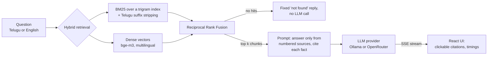

# Pathakam · పథకం సహాయకుడు

A Telugu/English helpdesk for Andhra Pradesh and Telangana welfare schemes. People ask in Telugu or English:
"Who is eligible?", "Which documents do I need?", "Where do I apply?" Pathakam answers **only from official
government documents**, with a numbered citation that opens the exact PDF page.

> Status: early prototype. The pipeline works end to end with a local model; the official document corpus
> and the evaluation set are still being built. Not an official government service.

## Why

Scheme rules live in GO PDFs and portal pages, many of them in Telugu, often in legacy fonts, and they change
every year. Citizens usually ask a middleman. A general chatbot will confidently invent amounts and deadlines.
Pathakam's design goal is the opposite: **answer from the source, cite it, and say "I don't know" otherwise.**

## How it works



| Part | Choice | Why |
|---|---|---|
| Keyword search | SQLite FTS5, `trigram` tokenizer | Telugu adds suffixes to words: రైతు, రైతుకు, రైతులకు. A trigram index matches substrings, so a short query word still finds the longer forms. |
| Query terms | Light Telugu suffix stripping (`text.py`) | The trigram index cannot match the other way round: the query word రైతులకు does not occur inside text that only has రైతు. Removing case and plural suffixes from query words fixes this, and a test covers it. |
| Vectors | `bge-m3` via Ollama, brute-force cosine in NumPy | Multilingual embeddings that include Telugu. At this corpus size (thousands of chunks), a matrix multiply is faster and simpler than a vector database. |
| Fusion | Reciprocal Rank Fusion (k=60) | Combines the two rankings without tuning score scales. |
| Chunking | Paragraph → sentence aware, overlapping, **never across pages** | Every citation points to exactly one page. |
| Ingestion check | Unicode script profile per page | Many AP/TS PDFs use pre-Unicode Telugu fonts and extract as gibberish (`¿=Ö Ôè·T`). Such pages are flagged for OCR rather than indexed as noise. |
| No-answer path | Empty retrieval → fixed reply | The model never gets a chance to guess when there is nothing to ground on. |
| LLM | `ChatModel` protocol, with Ollama and OpenRouter implementations | Prototype on a laptop for free, then switch with one environment variable. |
| Embedding safety | Index records its embedding model and dimension | Mixing vectors from two models fails loudly instead of silently ranking garbage. |
| Observability | Every answer reports retrieval ms, first-token ms, total ms, candidate counts | Shown in the UI, logged by the API, aggregated by `eval`. |

## Repository

```
backend/pathakam/
  api.py          FastAPI: /api/health, /api/documents, /api/chat (server-sent events)
  rag.py          prompt, grounding rules, streamed answer with timings
  retrieve.py     hybrid retrieval + RRF
  store.py        SQLite: documents, chunks, FTS5 trigram index, float32 embeddings
  text.py         normalisation, script detection, Telugu suffix stripping
  ingest/         PDF/text extraction and page-aware chunking
  llm/            provider protocol, Ollama and OpenRouter clients
  evaluate.py     retrieval and answer metrics
  cli.py          fetch | ingest | stats | ask | eval
backend/tests/    pytest suite (fake model providers, no network)
frontend/         React + Vite + TypeScript chat UI
data/sources.yaml manifest of official documents (the raw files and the index are not committed)
eval/             question-set format
```

## Run it

Requirements: Python 3.11+, Node 18+, [Ollama](https://ollama.com).

```bash
ollama pull gemma3:4b      # chat (any Ollama model works; set PATHAKAM_LLM_MODEL)
ollama pull bge-m3         # embeddings
cp .env.example .env       # optional: change models or switch to OpenRouter

# backend
cd backend
python -m venv .venv && source .venv/bin/activate     # Windows: .venv\Scripts\activate
pip install -e . pytest
pytest
python -m pathakam fetch                     # download files listed in data/sources.yaml
python -m pathakam ingest ../data/raw        # extract, chunk, embed, index
python -m pathakam ask "రైతు భరోసాకు ఎవరు అర్హులు?"
uvicorn pathakam.api:create_app --factory --reload

# frontend (new terminal)
cd frontend
npm install
npm run dev                                  # http://localhost:5173
```

To use a hosted model instead: set `PATHAKAM_LLM_PROVIDER=openrouter`, `PATHAKAM_LLM_MODEL=<model id>`
and `PATHAKAM_OPENROUTER_API_KEY` in `.env`.

## Evaluation

`eval/questions.example.jsonl` shows the format: the question, the document and pages that contain the
answer, and whether it is answerable at all.

```bash
python -m pathakam eval ../eval/questions.jsonl                 # retrieval: hit@k, MRR
python -m pathakam eval ../eval/questions.jsonl --answers --out ../eval/results/run.json
```

`--answers` also measures: share of answers with citations, citations that point to a real source, reply
language matches the question, unanswerable questions declined, answerable questions wrongly declined,
and latency p50/p95.

## Known limitations

- Romanised Telugu ("apply cheyyadaniki last date enti?") is detected as English, and keyword search
  cannot match it against Telugu script. Dense retrieval partly covers this; transliteration is on the roadmap.
- The suffix stripper is a heuristic, not a morphological analyser.
- Scanned and legacy-font pages are detected but not yet OCR'd.
- Small local models write uneven Telugu. A larger model through OpenRouter improves this.

## Roadmap

1. Corpus: official GO PDFs and guidelines for a first set of schemes, with `as_of` dates.
2. Evaluation set: about 100 Telugu, English and mixed questions, including unanswerable ones; publish baseline numbers.
3. OCR for legacy-font and scanned pages (Tesseract `tel`).
4. Romanised Telugu → Telugu script transliteration for queries.
5. Voice input and read-aloud (Telugu ASR/TTS).
6. Deployment: Docker, hosted demo.
